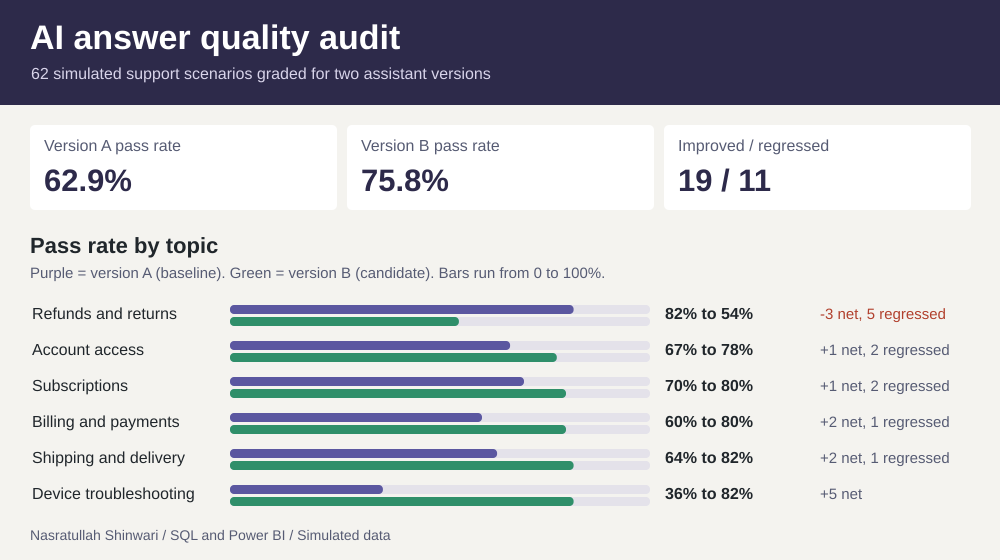

# AI answer quality audit

If an AI support assistant is updated, how can a team tell whether its answers improved and which failures still need attention? This case study grades two versions of a fictional retailer's support assistant on the same **62 simulated support scenarios** and shows why an overall pass rate is not enough to approve a release.



| Measure | Version A (baseline) | Version B (candidate) |
|---|---:|---:|
| Scenarios graded | 62 | 62 |
| Passed | 39 | 47 |
| Pass rate | 62.9% | 75.8% |
| Scenarios B fixed (A failed, B passed) | | 19 |
| Scenarios B broke (A passed, B failed) | | 11 |
| Failed in both versions | 4 | 4 |

### What the results suggest

**The headline hides a regression that matters.** Version B raises the overall pass rate by 12.9 points, mostly because it stops skipping troubleshooting steps: device troubleshooting rises from 36.4% to 81.8%. In the same release, refunds and returns falls from 81.8% to 54.5%, with 5 regressions in 11 scenarios and no improvements. Three of those regressions are wrong refund windows: scenario S001 tells a customer with a 12-day-old order that returns close after 14 days instead of 30, S007 tells a customer with a cracked blender that defective items are covered for 30 days instead of 90, and S011 offers a 30-day window on a software download that policy limits to 14 days. Each answer reads fluently, so a spot check would not catch it, and each one creates a refund the company would either wrongly deny or wrongly owe. A team that approved B on the overall rate would ship a worse refunds assistant.

**Failures still needing attention after B.** Of B's 15 failures, 4 state a wrong policy fact, 4 skip a required troubleshooting step, 5 leave out a required element such as the refund method or the next step, and 2 promise something policy does not allow. The [regressions export](results/regressions.csv) lists every scenario where A passed and B failed with both replies side by side, which is the review queue for the next release.

### How scoring works

Each scenario has a customer message, a reference answer, and a rubric of phrase checks in [rubric_checks.csv](data/rubric_checks.csv). A **required** phrase must appear in the reply (the correct refund window, the troubleshooting step, the refund method). A **forbidden** phrase must not (a wrong number, an unauthorized promise). A reply passes only when every required phrase is present and no forbidden phrase appears. The first check that trips sets the failure type: *Wrong policy fact*, *Missing required step*, *Incomplete answer*, or *Unsupported promise*. The recorded judgments in [judgments.csv](data/judgments.csv) are the reviewer record; the `rubric_audit` view re-grades every reply from the rubric and the tests confirm the two agree on all 124 responses.

The data are simulated. [build_audit_data.py](../tools/build_audit_data.py) generates the retailer's policies, the scenarios across six topics, both versions' replies, and the judgments from a fixed seed, so re-running it rewrites identical files. Realistic mistakes are injected on purpose: wrong refund and price-adjustment windows, skipped reset or firmware steps, promises to change a shipped address or waive a final-sale rule. No real company, policy, customer, or model output is involved.

### Explore the project

- **Any laptop, including a Mac:** Download the repository and open [dashboard.html](dashboard.html) locally. Filter by topic, by change from A to B, or by failure type; the pass rates and counts recalculate for the selection. Select **View** on any scenario to read the customer message, the reference answer, and both replies with their judgments.
- **Power BI Desktop (Windows):** Open [Audit.pbip](power-bi/Audit.pbip) with its adjacent report and model folders intact and select **Refresh** to load the embedded SQL snapshot. The first page has pass-rate cards, a topic slicer, a clustered bar chart of A and B pass rates by topic, and a scorecard. The second page is the detail view: slicers for topic, change, and B's failure type over a table of individual scenarios with both replies. The [DAX measures](power-bi/Audit.SemanticModel/model.bim) include `A pass rate`, `B pass rate`, `Pass rate change`, `Improved`, `Regressed`, and `Net change`.
- **SQL:** Read the [schema](sql/schema.sql) and [analysis views](sql/analysis.sql). `version_pass_rate` computes each version's pass rate, `scenario_comparison` pivots both judgments to one row per scenario and classifies the change, `topic_scorecard` and `failure_breakdown` break failures down by topic and type, and `regressions` shows the actual answers side by side for cases where A passed and B failed.

### Run the SQL

From the repository root, with Python 3.10 or newer and no extra packages:

```sh
python3 run.py                  # loads the CSVs into SQLite, runs the views, writes results/
python3 -m unittest -v test_ai_quality_audit
python3 tools/build_audit.py    # rebuilds dashboard.html, preview.svg, and the Power BI project
python3 tools/build_audit_data.py   # regenerates the simulated dataset (identical output)
```

The schema has a primary key on (scenario, version) for both responses and judgments, so a second result for the same pair cannot be loaded. The tests check that every scenario has exactly one result per version, that the version and topic pass rates reconcile to the scenario-level counts, that improvements minus regressions equal the change in passes, that the recorded judgments match the rubric, that the dashboard's embedded data equals the SQL export, and that every Power BI visual references a field that exists in the model.

### What was verified

The SQL, the tests, and the browser dashboard were run in this session; the dashboard was opened in Chromium and its cards and topic table matched the SQL results. The Power BI project is generated by the same builder functions as the other two reports in this portfolio, and the tests confirm its embedded snapshot has 62 rows and that every visual field exists in the model. Rendering in Power BI Desktop was not tested.
