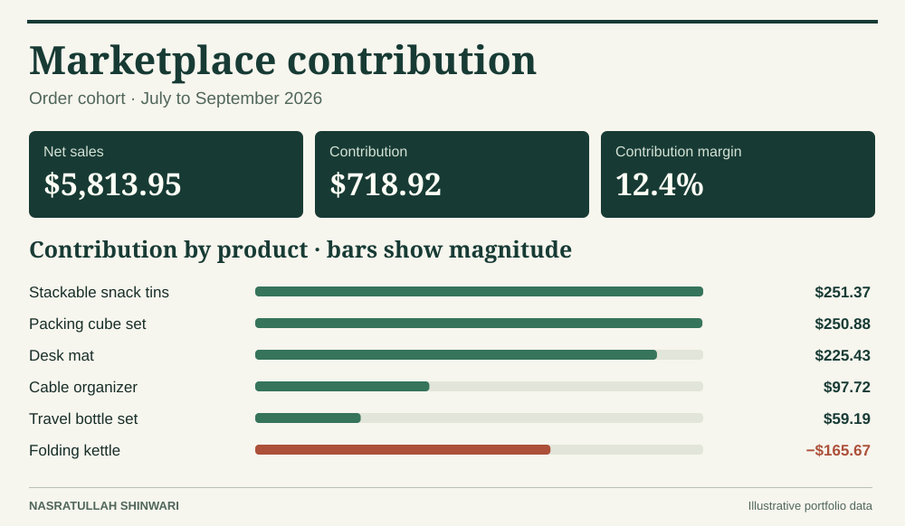

# Marketplace contribution

Which products should a seller review before increasing advertising spend? This case study examines 250 fictional order lines across six products in July–September 2026. The dashboard separates revenue from what remains after variable costs.

**Open the dashboard.** Download the repository and open [dashboard.html](dashboard.html) locally. Select an order month to update the product ranking, sales, refunds, contribution, and margin together.

### Findings

- Gross sales totaled **$6,243.70**. Refunds of **$429.75** reduced net sales to **$5,813.95**. Contribution was **$718.92**, or **12.4%** of net sales.
- The folding kettle generated **$1,121.66** in gross sales but **lost $165.67**. Its **$247.41 in refunds** alone represented about 22% of gross sales. Review return reasons and fulfillment costs before increasing ad spend.
- Stackable snack tins generated the highest contribution (**$251.37**), only **$0.49** ahead of packing cubes (**$250.88**). A small difference in shipping cost could reverse their rank.

### Definitions

| Metric | Calculation |
|---|---|
| Gross sales | Units × price paid per unit |
| Net sales | Gross sales − refunds |
| Contribution | Net sales − product cost − marketplace fees − shipping − advertising |
| Contribution margin | Contribution ÷ net sales. Undefined when net sales are zero. |

Money is stored as **integer cents** in all source and output CSVs. Product costs use the amount captured on the order line. Fees, refunds, and shipping charges are assigned to the original order month. Refunds do not restore inventory value in this sample. Fixed overhead and taxes are excluded, so contribution is not business net income.

### Trace a result

1. Explore the [raw order lines](data/order_lines.csv), [line charges](data/line_charges.csv), and [monthly advertising](data/advertising.csv).
2. The [SQL file](sql/analysis.sql) groups charges by line before joining to sales, then aggregates to one row per product and month before joining advertising. A month with advertising but no sales still records the expense.
3. Use the [monthly results](results/product_month.csv) to explain cost drivers or the [SKU ranking](results/sku_ranking.csv) to compare products over the full period.

Reproduce the exports and run reconciliation tests using the [main README](../README.md).
