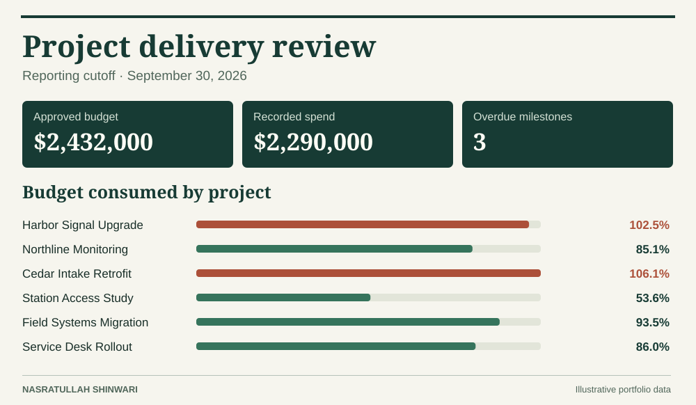

# Project delivery review

A portfolio manager needs to decide where to spend review time. This project compares posted spend with approved budgets and identifies unfinished milestones whose due dates have passed. The reporting cutoff is **September 30, 2026**.

**Open the dashboard.** Download the repository and open [dashboard.html](dashboard.html) locally. Select Transit, Utilities, or Technology to compare that program with the full portfolio. Windows users can also open the [native Power BI project](power-bi/Delivery.pbip) in a current Power BI Desktop installation and select **Refresh** to load the embedded sample. Keep the adjacent report and model folders together. The HTML dashboard is a separately generated view of the same SQL results.

### What the data show

| Measure | Result |
|---|---:|
| Approved budget | $2,432,000 |
| Spend posted through cutoff | $2,290,000 |
| Projects already over their approved budgets | 2 of 6 |
| Completed milestones | 15 of 24 |
| Open overdue milestones | 3 |

**First review:** Cedar Intake Retrofit is $46,500 over budget, with its readiness review overdue. Harbor Signal Upgrade is $12,000 over and also has an overdue readiness review. Station Access Study has the third overdue readiness review, despite spending less than its budget. Ask the project leads to explain cost drivers and confirm recovery dates. There is no forecast-at-completion field, so available budget on incomplete work is not evidence of savings.

### How the analysis works

- [Projects](data/projects.csv) contains one row per project. [Costs](data/costs.csv) contains individual postings in whole US dollars. [Milestones](data/milestones.csv) contains due and actual completion dates. [Report settings](data/report_settings.csv) stores one cutoff date.
- The [SQL views](sql/analysis.sql) total spend and count milestones separately before joining to projects. Joining the two detail tables directly would multiply costs. A completion or posting after the cutoff cannot affect the earlier snapshot.
- The [portfolio export](results/portfolio.csv) has one row per project. The [milestone detail](results/milestone_status.csv) explains each overdue count. A milestone due on the cutoff is “Due today.” A positive cost variance means spend exceeded budget.
- The Power BI [model](power-bi/Delivery.SemanticModel/model.bim) embeds the six-row SQL snapshot in Power Query. Its DAX measures calculate budget, spend, variance, overdue milestones, completion rate, and percentage of budget consumed within the selected program.

Run the commands in the [main README](../README.md) after changing the input CSVs. Rebuilding the Power BI project refreshes its embedded snapshot. The report definition JSON was checked against Microsoft's published schemas and the visual field references were matched to the model. Power BI Desktop rendering was not tested.
