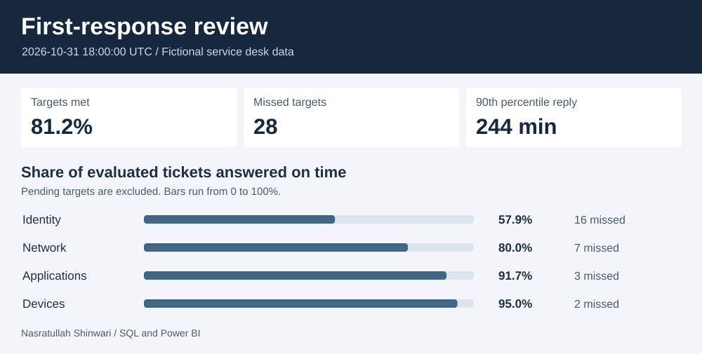

# IT service desk | First-response review

Which queues are missing their promised first human response, and which unanswered tickets should a lead review now? This case study reconstructs the service desk as it stood at **18:00 UTC on October 31, 2026**, using fictional ticket and event records.

| Measure | October snapshot |
|---|---:|
| Tickets opened by the cutoff | 152 |
| Evaluated / still within an unanswered window | 149 / 3 |
| On time / missed | 121 / 28 |
| Target met rate | 81.2% |
| 90th percentile first reply, answered tickets only | 244 minutes |
| Unanswered and already overdue | 4 |

### What a service desk lead can do

**Review Identity first.** It had 16 of the 28 misses and met its target for 22 of 38 evaluated tickets (57.9%). The queue's 90th percentile first reply was 334 minutes. Looking at the dashboard by priority can help distinguish differences in ticket mix from differences in handling time. Ticket records alone cannot establish the cause.

**Act on the current waiting list.** SD-145 in Identity was 220 minutes past its target. SD-146 in Network was 75 minutes overdue and marked Critical. Check both the size of the delay and ticket priority when assigning coverage. The [ticket export](results/ticket_outcomes.csv) includes the deadlines and observed replies for every case.

### Explore the project

- **Any laptop:** Download the repository and open [dashboard.html](dashboard.html) locally. Filter by queue and priority, review the live calculations for that selection, and expand the ticket table to inspect individual outcomes.
- **Power BI Desktop:** Open [Response.pbip](power-bi/Response.pbip) on Windows with its adjacent report and model folders intact. Select **Refresh** to load the embedded SQL snapshot. The first page compares queues and the second lets you inspect individual tickets by outcome and priority. See the [DAX measures](power-bi/Response.SemanticModel/model.bim).
- **SQL:** Read the [analysis](sql/analysis.sql), inspect the [queue scorecard](results/queue_scorecard.csv), or rebuild from the [source CSVs](data/). From the repository root, run `python3 run.py`, then `python3 tools/build_support.py` and `python3 -m unittest -v`. Python's standard library is sufficient.

### Measurement rules

| Question | Rule |
|---|---|
| When does a ticket enter the cohort? | Its opening time must be at or before the reporting cutoff. |
| What counts as a response? | The earliest human agent reply from opening through the cutoff. Automated acknowledgments and internal notes are ignored. |
| How much time is allowed? | Critical 30 minutes, High 90 minutes, Standard 240 minutes. These are illustrative 24/7 elapsed-time policies in UTC. |
| What if a reply lands exactly on the deadline? | It meets the target. An unanswered ticket at the exact deadline stays pending until that instant passes. |
| What is the denominator? | On-time replies, late replies, and already-overdue unanswered tickets. Pending tickets are excluded. |
| How is P90 calculated? | Sort observed first-reply durations and take rank `ceil(0.90 × answered count)`. It is recalculated for the selected tickets. |

The [Power BI builder](../tools/build_support.py) creates the report from the same ticket-level SQL export used by the browser dashboard. CSV inputs and timestamps are synthetic. The tests cover reporting cutoffs, duplicate replies, boundary cases, percentiles and report field references. Native report definitions were checked against Microsoft's schemas. Rendering in Windows Power BI Desktop was not tested.
